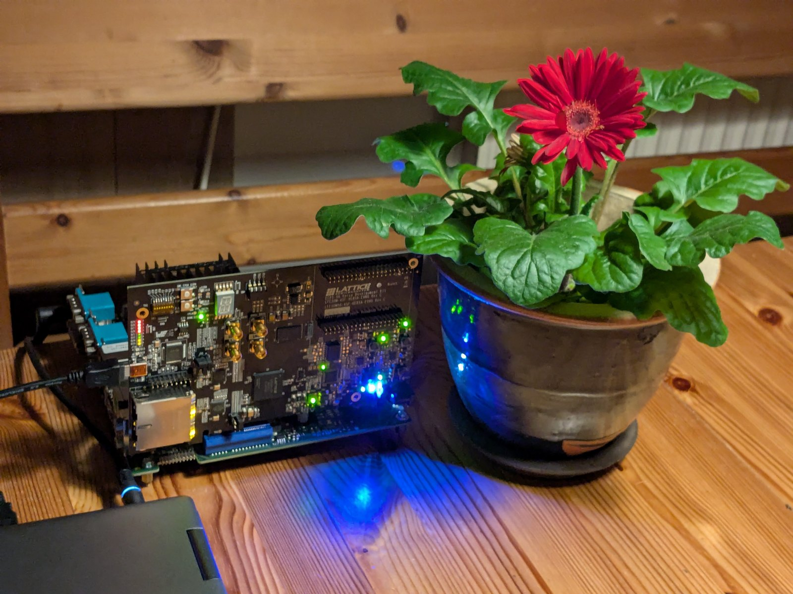

# ecp5-pcie-core

**An open-source PCI Express endpoint core for the Lattice ECP5: a free replacement for the vendor IP.**



*The Lattice ECP5 Versa board on the testbed. Photo: Dirk Eibach.*

This project is an open alternative to the vendor's PCI Express IP core: a PCI Express endpoint with BAR0 registers, MSI and scatter-gather DMA, written in open source, driven by the
unmodified LitePCIe Linux driver, and built with an open toolchain (yosys, nextpnr-ecp5, Project Trellis, openFPGALoader). It runs on the
**Lattice ECP5 Versa** board (LFE5UM-45F, the non-5G part), as a **Gen1 x1** endpoint so far.

The core is the soft PHY of [LitePCIe](https://github.com/enjoy-digital/litepcie) on the ECP5 transceiver, through
[LiteICLink](https://github.com/enjoy-digital/liteiclink). It is contributed upstream; this repository is the entry point: what it does, how to build and
run it, the tested configurations, and the tools and notes around it.

| What | Where |
|---|---|
| ECP5 lane adapter, DCU model, tests, Versa bench, driver ID | LitePCIe pull requests [#250](https://github.com/enjoy-digital/litepcie/pull/250) (draft), [#248](https://github.com/enjoy-digital/litepcie/pull/248), [#249](https://github.com/enjoy-digital/litepcie/pull/249) |
| `pcie` mode and analog attribute sets of `SerDesECP5` | LiteICLink pull request [#111](https://github.com/enjoy-digital/liteiclink/pull/111) |
| Discussion | [litepcie issue #20](https://github.com/enjoy-digital/litepcie/issues/20) |

Until the pull requests are merged, `setup/versions.lock` pins the exact versions to build. What is here is everything around the core: the **bring-up runbook** (what it took to make a real host enumerate the card, and how to diagnose each
failure), host-side tools that need no compiler or Python on the test machine, a live status monitor, and the hardware log.

> **Written by an AI agent.** The notes and tools were written by Claude Code (Claude Sonnet 5.5) under the supervision of Dirk Eibach, who
> reviewed them and ran all hardware tests.

## Status

Gen1 x1 on the testbed below: link training to L0, enumeration at boot, BAR0 access, MSI and DMA with the unmodified LitePCIe Linux driver.

| Result | Value |
|---|---|
| Enumeration | at boot, bitstream in the SPI flash |
| `dma_test` loopback | 1.66 Gbit/s, data checked |
| 15 minute DMA soak (host otherwise idle) | 22.8M buffers, 0 errors, no replay, no receiver error, no AER |
| 20 link cycles (unload, remove, Retrain Link, rescan, load, test) | 20 of 20, link back in 0.6 s |
| BAR0 without DMA | read 1.66 us, write with readback 8.4 us; 15 minutes, 106.5M writes and 426.0M memory words, 0 mismatches |
| Not done | 5 GT/s (the non-5G part tops out at 3.2 Gbit/s), x2 or wider, ASPM, more than one host |

## The testbed (to reproduce the results exactly)

| Part | Model |
|---|---|
| Board | Lattice ECP5 Versa Development Board, FPGA LFE5UM-45F-8BG381I (non-5G), in the x16 slot with one lane used |
| Host | Fujitsu FUTRO S920 thin client, mainboard D3313-G1, BIOS V4.6.5.4 R1.16.0 (American Megatrends), legacy boot |
| Host CPU, memory | AMD GX-222GC SoC (2 cores), 3.5 GiB |
| Root port | AMD Family 16h `1022:1439`; advertises 2.5 GT/s, x4 (this host cannot run faster than Gen1) |
| Host software | Arch Linux, kernel 6.12.10-arch1-1 |
| Power | the board is powered from the slot only; no external supply |
| Programming and debug | USB cable from the board (FT2232H) to a separate laptop: JTAG with openFPGALoader, UARTBone for the registers |
| Toolchain | OSS CAD Suite build of 2026-10-30 (the later builds fail to pack the design, see `docs/toolchain-notes.md`), nextpnr seed 1 |

The unit is an inexpensive second-hand machine that is widely available. Anything with a Gen1-capable slot should show the same behavior, but a
host whose BIOS does not hide an empty root port needs less care than this one (see the runbook).

## Three things that cost us days

1. **The BIOS hides the root port of the slot** unless a card links during the power-on self-test. The bitstream therefore has to be in the SPI
   flash (read at 62 MHz) and the host cold-booted. Loading the bitstream after boot does not work.
2. **Jumper J4 on pins 3 and 5 only.** It grounds the PRSNT net so that the clock manager passes the slot's 100 MHz reference clock.
3. **Never reconfigure the FPGA while the host runs with the card enumerated.** It froze the host. Halt the host first (`systemctl halt`, not
   power-off: the board needs the slot power for programming).

## Layout

| Path | Content |
|---|---|
| `docs/runbook.md` | The procedure that works, and a failure map |
| `docs/hardware-log.md` | Dated record of every hardware result, including the dead ends |
| `docs/serdes-adapter-design.md` | Design notes: what the adapter needs from the DCU and why |
| `docs/timing-check.md`, `docs/toolchain-notes.md` | Timing and resource feasibility; the toolchain regression and its workaround |
| `docs/prior-art.md` | The earlier work this builds on, with licenses |
| `docs/images/` | Photos; stripped of metadata (see the note in the candidate list) |
| `scripts/versa_monitor.py` | Live web status page over UARTBone: LTSSM, DCU, receiver counters, DMA, MSI, event log |
| `scripts/pcimem32.c`, `msi_probe.c`, `bar0_stress.c` | Static host tools: 32-bit BAR access, MSI test without a driver, BAR0 stress |
| `scripts/link_cycles.sh`, `soak_summary.sh`, `monitor_delta.py` | The link-cycle and soak procedures used for the results |
| `scripts/host_pcie_report.sh`, `bar0_test.py`, `dcu_status.py` | Read-only host report and register helpers |
| `setup/` | User-space toolchain installation (no root), the pinned dependencies (`versions.lock`) and the build script |
| `experiments/` | A feasibility build of the soft PHY on the Versa with a fabric-only lane |

## Quick start

```sh
# 1. Toolchain and the pinned LiteX, LitePCIe and LiteICLink (user space, no root), then the Versa image
./setup/install-toolchain.sh && ./setup/setup.sh && source env.sh
./setup/build.sh                        # about 20 minutes; bitstream, registers and Linux driver sources in build/versa/
# 2. Write the SPI flash with the host HALTED (see the runbook), then cold-boot the host
# 3. On the host
lspci -nn -s 01:00.0                      # expect 1204:ec11, Region 0 128K
insmod litepcie.ko && ./litepcie_util dma_test -w 32 -t 8
# 4. Status page on the laptop
python3 scripts/versa_monitor.py --csr-csv build/versa/csr.csv --uart-port auto
```

Keep the test host otherwise idle during a soak: on this slow CPU other commands make the DMA ring overrun, and `dma_test` then reports
lost buffers as errors.

## Credits

- **LitePCIe, LiteICLink and LiteX** by Florent Kermarrec and Enjoy-Digital: the soft PHY and the transceiver wrappers this builds on.
- **Yumewatari** by whitequark (0BSD): the documentation of the ECP5 DCU, the PCI Express mode attributes and the receiver detection sequence.
- **katsuo-pcie** by Vegard Storheil Eriksen (MIT): an Amaranth PCI Express stack that enumerates on this board and confirmed the DCU settings.
- **Project Trellis**, **yosys**, **nextpnr** and **openFPGALoader**: the open toolchain.
- Lattice documentation (TN1261, the Versa board guide) for the transceiver and board facts.

No code was copied from projects that have no license.

## License

- The tools and scripts (`scripts/`, `setup/`, `experiments/`, `env.sh`): [BSD-2-Clause](LICENSE).
- The documentation (`docs/`, this README) and the photo: [CC-BY-4.0](LICENSE-docs).
- The dependencies fetched by `setup/setup.sh` (LiteX, LitePCIe, LiteICLink, Migen, LiteScope) keep their own licenses (BSD-2-Clause for the Enjoy-Digital projects).
